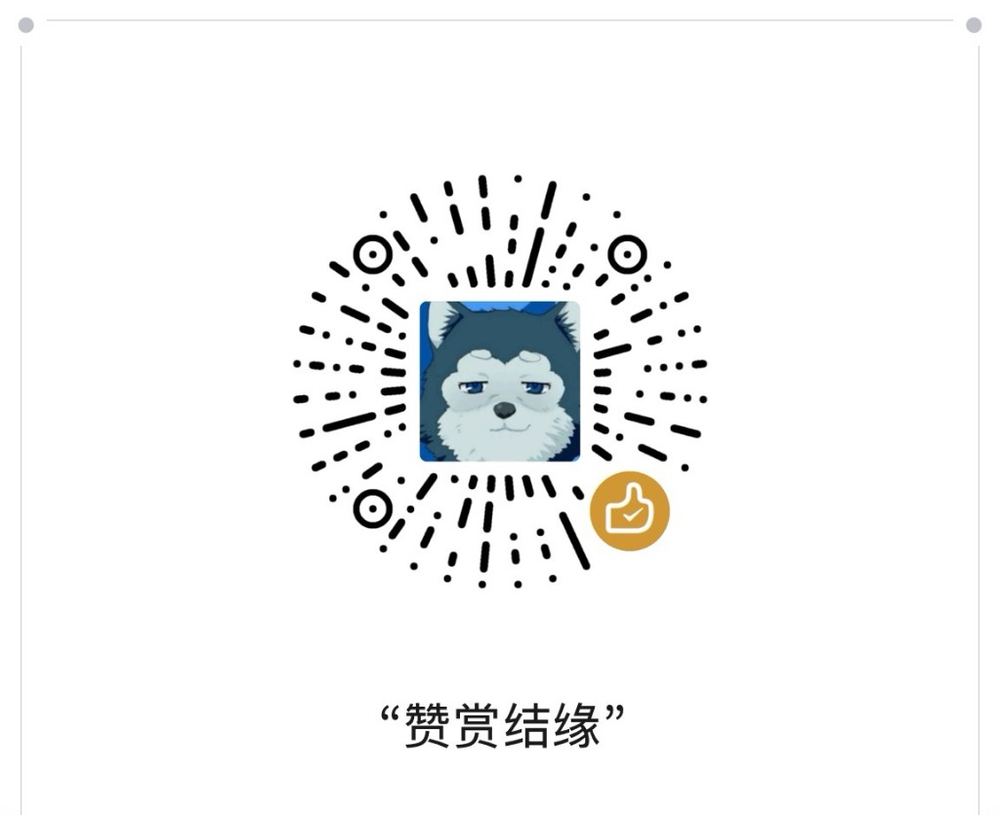

# SCA · Sticker Creation Assistant

**AI 贴图创作助手**（Sticker Creation Assistant）——面向微信贴图号创作者的本地文案工作台。

用关键词批量生成可发布图文，支持改写长文、讨论引导、无版权图库配图，以及 Windows 桌面端打包。API Key 与内容库只保存在本机，**不会上传到任何服务器**。

## 功能概览

- **批量创作**：关键词 → 选题 → 批量生成正文 / 标题 / 讨论引导
- **长文改写**：一键缩略 / 保留关键改写，去 AI 味润色，标题封面生成
- **内容库**：本地 SQLite 持久化，收藏、复制、继续配图
- **配图**：Unsplash / Pexels / Pixabay 检索与本地缓存（需自行配置图库 Key）
- **桌面端**：Electron 打包 Windows 安装包，数据落在用户目录

## 技术栈

| 层级 | 技术 |
|------|------|
| 前端 | Vue 3 · TypeScript · Vite · Element Plus · Pinia |
| 后端 | Fastify · better-sqlite3 |
| 桌面 | Electron · electron-builder（NSIS） |
| AI | OpenAI Compatible（推荐 DeepSeek） |

## 快速开始

### 环境要求

- Node.js 20+（推荐 22）
- npm 或兼容包管理器

### 安装与启动（网页开发）

```bash
git clone https://github.com/wl-o/SCA-StickerCreationAssistant.git
cd SCA-StickerCreationAssistant
npm install
npm run dev
```

启动后：

- 前端：http://localhost:5173/
- 本地 API：http://127.0.0.1:8787/

### 常用脚本

| 命令 | 说明 |
|------|------|
| `npm run dev` | 同时启动前端 + 本地 API |
| `npm run build` | 构建前端生产包 |
| `npm run electron:dev` | Electron 联调（勿与 `npm run dev` 同时抢端口） |
| `npm run electron:build` | 打 Windows NSIS 安装包，产物在 `release/` |

## Windows 安装包

可直接下载已打包的 Windows 安装包（无需自己编译）：

- **[Releases · SCA-StickerCreationAssistant](https://github.com/wl-o/SCA-StickerCreationAssistant/releases)**  
  下载最新的 `AI贴图创作助手-*-Setup.exe`，安装后打开即可使用。

安装后请到「设置」里自行填写 DeepSeek API Key（以及可选的配图图库 Key）。本仓库与安装包内**不包含**任何密钥。

## 配置说明

首次打开左侧 **设置** 页面完成配置。所有 Key **只写进本机 SQLite**（开发环境在项目 `data/`，桌面版在 `%AppData%`），请勿把真实 Key 提交到 Git。

### 1. AI 模型（必填）

推荐 DeepSeek：

| 项 | 建议值 |
|----|--------|
| Provider | DeepSeek |
| Base URL | `https://api.deepseek.com/v1` |
| Model | `deepseek-flash` |
| API Key | 在 [DeepSeek 开放平台](https://platform.deepseek.com/) 自行申请，填入设置页 |

旧模型名 `deepseek-chat` / `deepseek-v4-flash` 已退役，请使用 `deepseek-flash`。

也可选用 OpenAI 或任意 OpenAI Compatible 接口（自行填写 Base URL 与 Model）。

### 2. 配图图库（可选）

在设置 → **配图图库** 中配置其一即可开始搜图：

- Unsplash Access Key
- Pexels API Key
- Pixabay API Key

未配置时仍可创作文案，但无法在线搜图配图。

### 3. 人设与模板

- **人设**：影响文风与视角，可在「人设」页编辑
- **模板**：可在「模板」页管理 Prompt 模板

## 目录结构（简）

```text
├── src/                 # Vue 前端
├── server/              # Fastify + SQLite API
├── electron/            # Electron 主进程
├── docs/images/         # 文档图片（含赞赏码）
├── data/                # 本地数据（已 gitignore，勿提交）
└── release/             # 安装包输出（已 gitignore）
```

## 隐私与安全

- 仓库 **不包含** 任何 API Key、内容库数据库或生成图片
- 请勿将 `.env`、`data/app.sqlite`、截图中的 Key 提交到公开仓库
- 若 Key 曾泄露，请尽快在对应平台作废并更换

## 赞赏结缘

如果 SCA 对你有帮助，欢迎微信扫码随缘赞赏，一杯咖啡也是动力。谢谢支持！

<p align="center">
  
</p>

<p align="center"><b>赞赏结缘 · 随缘即可</b></p>

## License

本项目以源码形式开放，供学习与个人使用。商用前请自行确认所调用的 AI / 图库服务条款。
